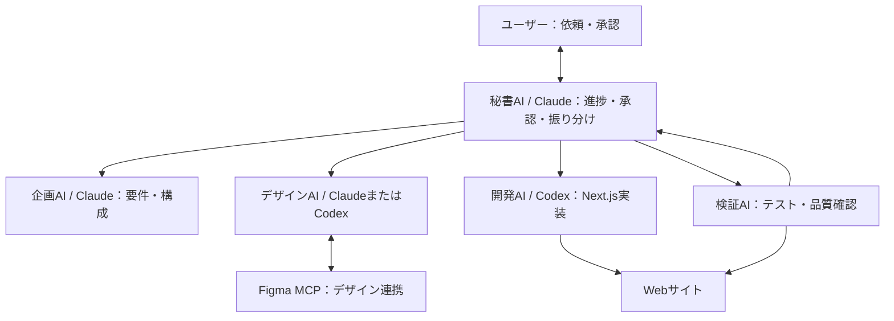
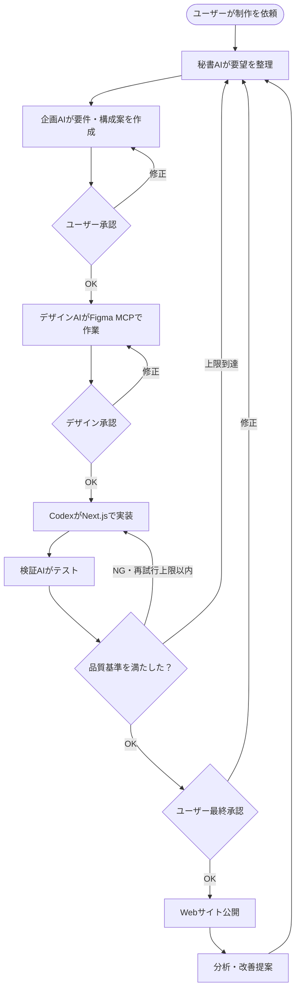

# AIエージェントによるWebサイト制作自動化システム

## 1. 全体構成図 — 誰が何を担当するか

ユーザーの依頼を秘書AIが受け、専門エージェントへ仕事を割り振る。



| 担当 | 仕事 |
|---|---|
| ユーザー | 目的の提示・重要事項の承認 |
| 秘書AI | タスク分配・進捗管理・承認依頼 |
| 企画AI | 要件定義・サイト構成 |
| デザインAI | デザイン案・Figma連携 |
| 開発AI | Next.js実装 |
| 検証AI | 動作確認・問題点の報告 |

## 2. 実行フロー図 — どう仕事が進むか



- 秘書AIが担当を決め、結果を受け取る。
- 要件・デザイン・公開など重要な段階ではユーザーに承認を求める。
- テストで問題があればCodexに修正を依頼する（再試行回数には上限を設ける）。
- 公開後の分析結果を次の改善タスクに反映する。

## 3. ファイル構成図 — AIの役割をどう設定するか

```text
ai-web-factory/
├── CLAUDE.md                  # Claudeの共通ルール
├── AGENTS.md                  # Codexの共通ルール
├── .claude/
│   ├── agents/
│   │   ├── secretary.md       # 秘書AIの役割
│   │   ├── planner.md         # 企画AIの役割
│   │   └── designer.md        # デザインAIの役割
│   └── skills/
│       ├── planning/SKILL.md  # 企画の作業手順
│       └── design/SKILL.md    # デザインの作業手順
├── .agents/
│   └── skills/
│       ├── frontend/SKILL.md  # Codexの実装手順
│       └── testing/SKILL.md   # Codexのテスト手順
├── orchestrator/
│   ├── main.py                # 実行入口
│   └── workflow.py            # AI呼び出し・承認・再試行制御
├── docs/
│   ├── requirements.md        # 要件
│   ├── design.md              # デザイン方針
│   └── tasks.md               # 作業状況
└── website/
    ├── src/
    ├── public/
    └── package.json
```

| 項目 | 役割 |
|---|---|
| `CLAUDE.md` / `AGENTS.md` | AIに守らせるルール |
| `agents/` | 専門エージェントの担当定義 |
| `skills/` | 繰り返し使う作業手順 |
| `orchestrator/` | どのAIをいつ動かすか、承認待ち・再試行を管理 |
| `docs/` | AI間で共有する要件・設計・進捗 |
| `website/` | 開発対象のサイト |

**注意：** 指示ファイルを配置するだけでClaudeとCodexが自動連携するわけではない。実際の連携にはCLI・SDKなどを使ったオーケストレーターが必要。また、Figma MCPで作成・編集できる範囲は利用するMCPサーバーの機能による。

## 目指す姿

**人間が目的と重要な判断を担い、秘書AIが専門エージェントに仕事を割り振って、Webサイトの制作・検証・改善を進める。**
